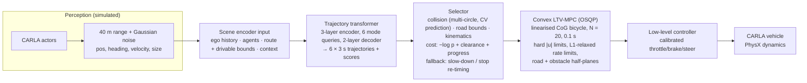

# Transformer-Guided MPC for Low-Speed Autonomous Driving (CARLA)

Hybrid motion planning for the TiHAN campus vehicle: a **multimodal trajectory transformer** proposes
candidate paths, a **feasibility/cost selector** rejects unsafe ones, and a **convex LTV-MPC (OSQP)**
tracks the chosen path with hard actuator limits and linear safety half-planes. It is benchmarked in
closed loop in **CARLA 0.9.13** against

1. a faithful port of the **lab stack** in `MPC_capsule` (CasADi/IPOPT kinematic MPC + Livox-ROI speed governor), and
2. a properly built **capsule-constraint NMPC** (non-convex multi-circle collision constraints inside one NLP).

> **Branch `dev` is a ground-up rebuild.** Everything reported below is produced by the code in this
> branch and can be regenerated with `scripts/run_all.sh`. See [What changed vs `main`](#what-changed-vs-main).

<!-- RESULTS -->

---

## Architecture



| Component | File | Notes |
|---|---|---|
| Lab stack port | [`tmpc/controllers/lab_mpc.py`](tmpc/controllers/lab_mpc.py) | `KinMPCPathFollower` with the deployed tuning (N = 10, DT = 0.4, Q = [300, 300, 100, 10], R = [10, 2000], 0.1 s IPOPT budget, warm start), the 0.8 m/s² reference ramp of `ref_gps_traj.py`, and the Livox ROI guard of `acs1_nav_test7_3.py` (1.3 m half-width corridor, 25 m look-ahead, `v = 40 − 40·exp(−0.04(d − 7))` km/h, emergency brake below 15 m). |
| Capsule-constraint NMPC | [`tmpc/controllers/capsule_nmpc.py`](tmpc/controllers/capsule_nmpc.py) | Same IPOPT model; ego = 3 circles, obstacles = 1–4 circles each with constant-velocity prediction; hard separation constraints with a heavily penalised slack; drivable-area constraints; shifted warm start. |
| Convex LTV-MPC | [`tmpc/controllers/ltv_mpc.py`](tmpc/controllers/ltv_mpc.py) | Strictly convex QP: dynamics linearised along the reference, solved by OSQP. |
| Trajectory transformer | [`tmpc/planning/model.py`](tmpc/planning/model.py) | 1.3 M parameters; typed tokens with padding masks (variable number of agents), learned mode queries with cross-attention, integrated per-step displacements, winner-takes-all loss + mode classification, history dropout against the copycat problem. |
| Selector | [`tmpc/planning/selector.py`](tmpc/planning/selector.py) | The "feasibility & cost selector" of the original design, now implemented. |
| Expert (data) | [`tmpc/expert/lattice.py`](tmpc/expert/lattice.py) | Privileged Frenet lattice planner (ground-truth agents) + the same LTV-MPC; per-episode random left/right preference makes the demonstrations genuinely multimodal. |
| CARLA environment | [`tmpc/sim/carla_env.py`](tmpc/sim/carla_env.py) | Synchronous 20 Hz physics, 10 Hz control, compute latency applied in sim time, noisy perception, Traffic-Manager traffic, scripted parked cars / cones / pedestrians / leaders / oncoming cars. |

### Simulation realism

* **Vehicle**: CARLA `vehicle.nissan.micra` (wheelbase 2.49 m measured from the wheel positions). The
  kinematic model, constraints and limits follow the lab controller (`a ∈ [−3, 0.8] m/s²`,
  `|δ| ≤ 0.75 rad`, jerk/steer-rate limits ±1.5 m/s³ / ±0.75 rad/s).
* **Actuation**: commands go through a low-level controller whose feed-forward maps were measured on the
  ego blueprint ([`scripts/calibrate_lowlevel.py`](scripts/calibrate_lowlevel.py),
  [`results/lowlevel_calibration.json`](results/lowlevel_calibration.json)); CARLA's engine/gearbox lag
  and strong engine braking are therefore part of the loop.
* **Latency**: each command is applied only after the controller's measured wall-clock compute time has
  elapsed in simulation time, so slow solvers pay for it.
* **Perception**: all evaluated stacks receive the same object list (40 m range; σ = 0.10 m position,
  0.03 rad heading, 0.15 m/s velocity, 0.05 m size). Only the data-generating expert sees ground truth.
* **Collisions**: CARLA collision sensor **or** oriented-box overlap with any agent.

### Scenarios

| Template | Description |
|---|---|
| `blocked` | parked vehicle partially/fully blocking the ego lane |
| `blocked_oncoming` | blocked lane + oncoming vehicle in the passing lane |
| `slalom` | two parked vehicles on alternating sides |
| `cones` | tapered construction-cone closure (optionally a street barrier) |
| `walker` | pedestrian crossing, triggered by the ego's approach |
| `leader` | slow lead vehicle (1.8–3 m/s) in the ego lane |
| `mixed` | blocked lane + crossing pedestrian + 15–35 Traffic-Manager vehicles |
| `traffic` | route following in background traffic |

Every scenario is fully determined by `(town, template, seed)`, so all controllers face identical
conditions. Training data comes from **Town01 and Town05**; evaluation uses the **held-out Town02**.
(Town03 was planned as a third training town, but the CARLA 0.9.13 server on this machine segfaults
reproducibly while loading it.)

### Learning setup

* **Demonstrations**: the privileged lattice expert drives (35 % of episodes contain steering /
  acceleration noise bursts so recovery states are visited, cf. ChauffeurNet).
* **Targets = the expert's plan, not the executed motion.** The transformer replaces the planner,
  so it is supervised with the 3 s reference the expert hands to the tracker. Plans are reconstructed
  offline by re-running the deterministic expert on every recorded frame
  ([`scripts/build_dataset.py`](scripts/build_dataset.py)). Training on executed motion instead
  taught the model CARLA's ~1 s launch dead time, which the tracker then applied a second time – the
  car never pulled away from standstill.
* **DAgger** (one round): the first model drives in the training towns, the expert takes over for 4 s
  whenever the learner is stuck for 3 s, and every visited state is labelled with the expert's plan.
* **Loss**: winner-takes-all regression on the closest of 6 modes + cross-entropy on which mode wins;
  perception-noise augmentation and history dropout.
Desired speed is 3–5.5 m/s (campus speeds). An episode fails on collision, leaving the drivable area
for > 1 s, 30 s at standstill ("freeze"), or the time limit.

---

## What changed vs `main`

The `main` branch could not support its claims. Measured problems (details in the commit history):

* **The reported numbers were not produced by the code.** Running `benchmark_comparison.py` gave the
  hybrid **0 %** solver success and **95 ms** mean latency (README: 99.2 % / 7.4 ms), and the capsule
  baseline **100 %** / 44 ms (README: 68.4 % / 48.2 ms). The benchmark repeated one identical input 20
  times, so it could only ever report 0 % or 100 %.
* **The transformer was never trained** (no data, loss or checkpoint); its output was random.
* **"Convex QP via OSQP"** was actually SciPy SLSQP on the nonlinear bicycle; OSQP was never imported.
* **No safety mechanism**: the "Feasibility & Cost Selector" did not exist; "Guaranteed Feasible" was a
  hard-coded string.
* **No CARLA code** despite the repository name.
* **The three PDFs in `papers/` were unrelated papers** (two algebraic-geometry papers and an aircraft
  collision-avoidance paper) – removed; real references are listed below.
* **The baseline did not describe the lab's stack**: `MPC_capsule` is a path-following kinematic MPC
  with an external LiDAR speed governor, not an MPC with capsule constraints. Both are now evaluated.

---

## Reproduce

```bash
# Python 3.8 is required by the CARLA 0.9.13 client wheel
uv venv --python 3.8 .venv
uv pip install --python .venv/bin/python -r requirements.txt
uv pip install --python .venv/bin/python torch --index-url https://download.pytorch.org/whl/cu121

.venv/bin/python -m pytest -q tests          # CARLA-free unit tests (~15 s)

# full pipeline (starts a supervised headless CARLA server if none is running)
CARLA_ROOT=~/CARLA scripts/run_all.sh 600 10
```

Individual steps: `scripts/collect_data.py` → `scripts/build_dataset.py` → `scripts/train.py` →
`scripts/evaluate.py` → `scripts/report.py`. CARLA 0.9.13 occasionally segfaults on map loads;
[`scripts/carla_server.sh`](scripts/carla_server.sh) restarts it and the collection/evaluation scripts
reconnect and resume.

## Repository layout

```text
tmpc/
  vehicle.py, geometry.py, types.py
  controllers/  lab_mpc.py  capsule_nmpc.py  ltv_mpc.py
  planning/     features.py  model.py  selector.py  safety.py  hybrid.py
  expert/       lattice.py
  sim/          carla_env.py  scenarios.py  runner.py  kinematic.py
scripts/        carla_server.sh  calibrate_lowlevel.py  collect_data.py  build_dataset.py
                train.py  evaluate.py  report.py  run_all.sh
tests/          test_core.py
results/        summary.md  summary.json  figures/  town02/episodes.jsonl
checkpoints/    planner.pt  planner_history.json
```

## References

* Dosovitskiy et al., *CARLA: An Open Urban Driving Simulator*, CoRL 2017.
* Kong, Pfeiffer, Schildbach, Borrelli, *Kinematic and Dynamic Vehicle Models for Autonomous Driving Control Design*, IEEE IV 2015.
* Andersson et al., *CasADi: a software framework for nonlinear optimization and optimal control*, Math. Prog. Comp. 2019.
* Stellato et al., *OSQP: an operator splitting solver for quadratic programs*, Math. Prog. Comp. 2020.
* Werling, Ziegler, Kammel, Thrun, *Optimal Trajectory Generation for Dynamic Street Scenarios in a Frenét Frame*, ICRA 2010.
* Shi, Jiang, Dai, Schiele, *Motion Transformer with Global Intention Localization and Local Movement Refinement*, NeurIPS 2022.
* Nayakanti et al., *Wayformer: Motion Forecasting via Simple & Efficient Attention Networks*, ICRA 2023.
* Janner, Li, Levine, *Offline Reinforcement Learning as One Big Sequence Modeling Problem*, NeurIPS 2021.
* Bansal, Krizhevsky, Ogale, *ChauffeurNet: Learning to Drive by Imitating the Best and Synthesizing the Worst*, RSS 2019.
* Codevilla, Santana, López, Gaidon, *Exploring the Limitations of Behavior Cloning for Autonomous Driving*, ICCV 2019.
* Trautman, Krause, *Unfreezing the Robot: Navigation in Dense, Interacting Crowds*, IROS 2010.
* Zeng, Zhang, Sreenath, *Safety-Critical Model Predictive Control with Discrete-Time Control Barrier Function*, ACC 2021.

## Author & Research Affiliation

* **Bavan P** — Graduate Student Researcher, Department of Smart Mobility, **IIT Hyderabad / TiHAN National Autonomous Navigation Hub**.
* **Supervisor:** Director, TiHAN – IIT Hyderabad
* **GitHub:** [@BavanPrabahar](https://github.com/BavanPrabahar)
